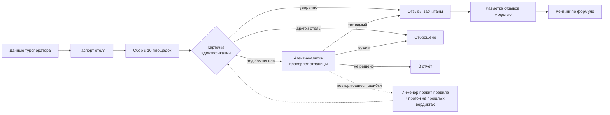

# Аналитик отелей: проверка «тот ли это отель» и честный рейтинг

*Часть системы «Гид по миру». Статус: работающий прототип на этапе валидации — база растёт, правила сверки уточняются по аудиту. Рейтинги пока используются внутри, публично не выдаются за проверенные.*

## Проблема
Турагенту нужен честный ответ «какой это отель на самом деле», а не средняя звёздочка с одного сайта. Отзывы разбросаны по десятку площадок, и главная ловушка — **чужие отзывы**:
- одноимённые отели в другом городе или стране;
- соседний отель той же сети с похожим названием;
- переименованные отели;
- страницы целого комплекса вместо одного отеля.

Одна ошибочная привязка — и в рейтинг отеля попадают жалобы на совсем другое место.

## Как работает

**1. Паспорт отеля.** Из данных туроператора (через Tourvisor — сервис, которым пользуются турагенты) собирается эталон:
- название и бывшие названия, страна, курорт, звёзды;
- точка на карте, адрес, телефон;
- контакты с официального сайта отеля, каждый проверен на самой странице.

**2. Сбор.** Программа ищет отель на площадках отзывов (TopHotels, Отзовик, Trip.com, Google, Яндекс, Viasun, Travelata, Островок, Турправда, Tripadvisor) по всем вариантам названия.

**3. Карточка идентификации.** Каждая найденная страница сверяется с паспортом по полям:
- **сильные признаки:** точка на карте в пределах 500 м, адрес (номер дома рядом с улицей), телефон, полное название в том же порядке;
- **слабые признаки:** часть названия, курорт, звёзды (разница в одну звезду — обычное дело между сайтами);
- **решающие против:** другая страна или курорт на странице, точка дальше 2 км без полного названия, подмена отеля сети.

**4. Развилка.**
- **«Уверенно»** — достаточно доказательств и ничего против → отзывы засчитываются.
- **«Другой отель»** → страница отбрасывается.
- **«Под сомнением»** → отзывы **не засчитываются**, случай уходит на проверку модели (агент-аналитик). Он открывает страницы, сверяет адрес, бывшие названия, сайт отеля и выносит вердикт: тот самый, чужой или не удалось решить.

**5. Разметка и рейтинг.** Только проверенные отзывы размечает модель: пункт (номер, питание, пляж, сервис…), плюс или минус, тяжесть 1–4, цитата. Рейтинг считает формула, не модель:
- «долгоживущие» пункты (номер, пляж, территория) и «меняющиеся» (питание, сервис, уборка) учитываются по-разному;
- свежие отзывы важнее старых;
- повторяющиеся серьёзные жалобы (клопы, отравления) поднимаются наверх карточки.

**6. Аудит.**
- Агент-аналитик дважды в день разбирает журнал сборщика и пишет отчёт: какие ошибки сборщика повторяются и что в нём исправить.
- Независимые выборочные проверки делает второй агент (Codex).
- Разработчик (Claude Code) по отчётам меняет правила. **Каждое новое правило перед включением прогоняется на всех прошлых вердиктах аналитика:** сколько своих страниц оно добавит и не пропустит ли чужие.

## Результаты на сегодня (по журналам и отчётам)
- В базе 630+ отелей (Турция, Египет, ОАЭ, Таиланд, Вьетнам, Мальдивы, Греция), в очереди около 1300.
- **Выборочные проверки вторым агентом**, по 30 карточек: чужих страниц среди засчитанных — 0 из 118 в первой, 3 из 127 во второй. Все три — не случайные отели, а **соседние отели той же сети на том же курорте**: у отеля не было паспорта, а его название — одно слово, общее для всей сети. Причина закрыта правилом: без паспорта однословное название не засчитывается до проверки аналитиком.
- **Аудит показал перекос в осторожность:** в одном разборе из 162 страниц, которые сборщик отложил или отбросил, своими оказались 135, чужими 17, ещё 10 аналитик не смог решить. Ни одна чужая не попала в оценку. По этим разборам правила уточнены: бывшие названия на странице, «by» и дефисы в названиях, звёзды ±1, страницы без звёзд. На прошлых вердиктах аналитика это +71 своя страница и −1 чужая. Каждая доработка закреплена тестом.
- Одна площадка ограничивает частые заходы: для неё сделан отдельный медленный сборщик, а проверочную картинку оператор решает в Telegram-боте одним сообщением.

## Что ещё не сделано
- Валидация на большой выборке после последних правил — по ходу пересборки базы.
- Кириллические названия на картах сверяются пока только по точке на карте.
- Публичные рейтинги — после завершения валидации.
